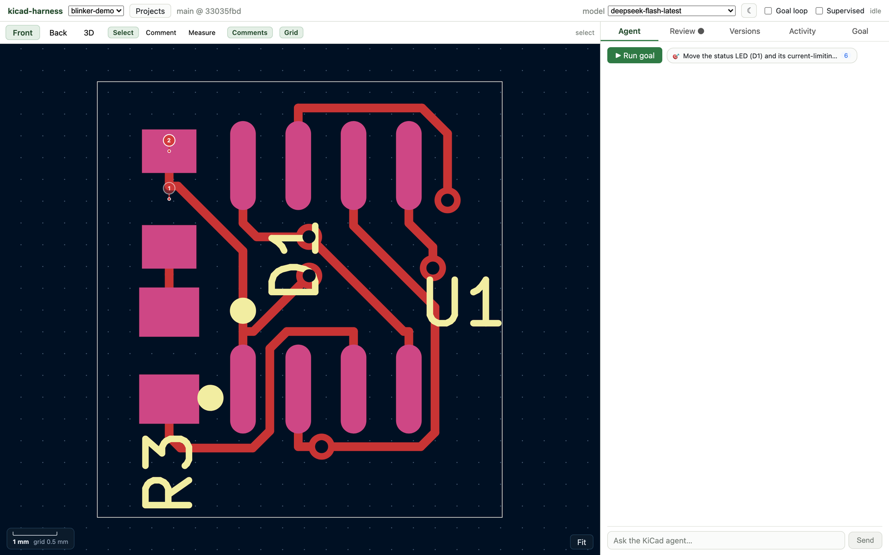
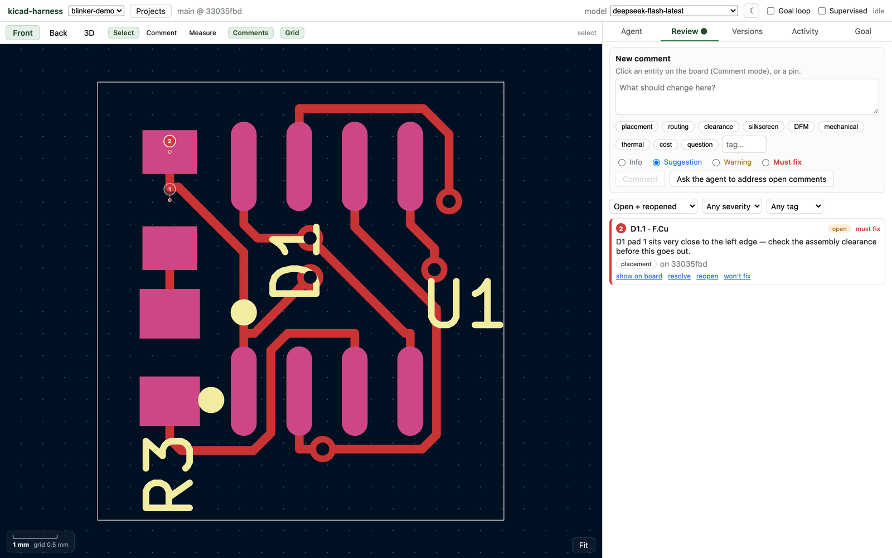
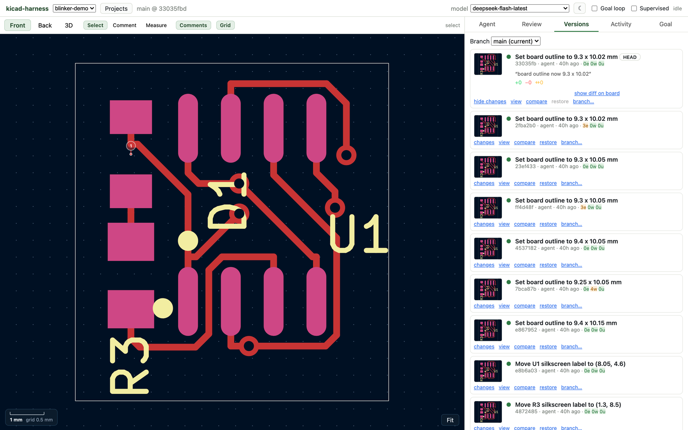
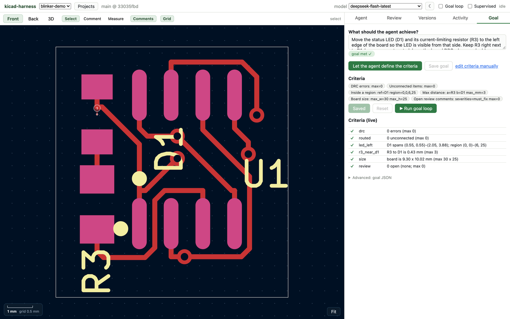
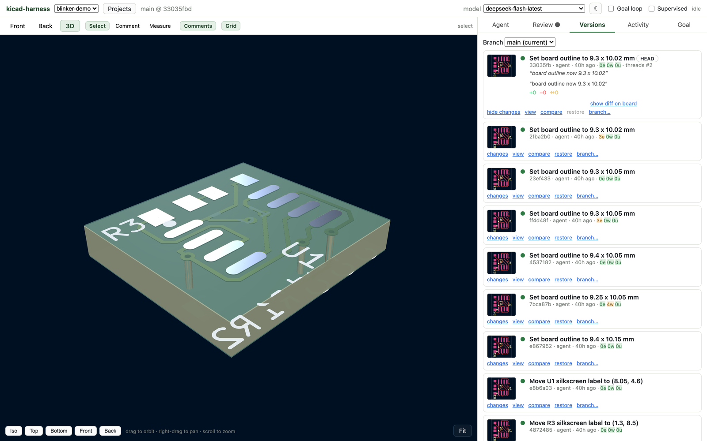

# auto-kicad

**An agent that designs PCBs in KiCad while you watch, comment, and roll back.**

auto-kicad is a research harness for AI-driven board design. A Pydantic AI agent edits a
real KiCad 10 board through a set of CAD tools — placement, routing, outline, zones,
silkscreen — while a web UI streams the board, the agent's reasoning, and every version
it commits. You can click any pad, track or via to leave a review comment, and the agent
reads those comments on its next pass. A goal loop keeps it working until machine-checkable
criteria (DRC counts, board size, distances, regions, open comments) pass.



## What's in the box

- **Headless agent core** (`harness/`) — Pydantic AI agent with KiCad tools, a git-versioned
  design workspace, a goal loop, and a FastAPI/AG-UI server.
- **Live web UI** (`harness/web/`) — CopilotKit chat, 2D board viewer with review pins,
  measure mode, version browser, goal editor, and a real three.js 3D viewer.
- **Demo pipeline** (`demo/`) — a 555 LED blinker taken from parts search to a routed,
  DRC-clean board, using a pure-Python S-expression layout library.
- **PCB knowledge base** (`.claude/`) — 25 rules and a skill covering stackup, placement,
  routing, DFM, EMC, thermal, high-speed and more, loaded as agent context.

## How it works

```
you ── chat / review pins ──▶ FastAPI + AG-UI ──▶ Pydantic AI agent
                                   │                    │ tools
                                   │                    ▼
                              SQLite store        kicad_harness tools
                          (runs, comments,        (place, route, outline,
                           versions, settings)    nets, zones, DRC, render)
                                   │                    │
                                   │                    ▼
                             web UI (React)      KiCad Python worker
                          board · 3D · diffs     (pcbnew, kicad-cli)
                                   │
                                   └──────── design workspace (git)
                                             one commit per edit
```

Every edit is a commit in the design's own git repository, so "version" means the same
thing to the agent, the UI, and you. The UI fetches the same board file the agent edits,
so what you see is what it changed.

## Screenshots

### Review: click the board, leave a comment

Comment pins are anchored to a pad, track, via or footprint. The agent sees open comments
as part of its context and can reply or address them; `open_threads` is also a goal
criterion, so "no open must-fix comments" is machine-checkable.



### Versions: thumbnails, diffs, and a one-line note

Each revision shows a rendered thumbnail, the DRC counts at that commit, an inline diff
against its parent, and a few-word LLM summary generated from the real entity diff.



### Goals: describe it, the agent writes the criteria

You state the goal in words. The agent inspects the board and calls `set_goal` with
machine-checkable criteria, then runs `check` against them. The Goal tab shows the
criteria it chose and their live pass/fail state.



### 3D: the actual board model

The 3D tab exports KiCad's GLB for the revision and renders it with three.js —
orbit, pan, zoom, and preset views. Vias are real holes at their real positions.



## Quick start

Prerequisites: macOS, [KiCad 10](https://www.kicad.org/) at
`/Applications/KiCad/KiCad.app`, Python 3.12, [uv](https://docs.astral.sh/uv/), Node 22+,
and Homebrew `cairo`.

```bash
git clone --recurse-submodules https://github.com/roboalchemist/auto-kicad.git
cd auto-kicad/harness

uv venv --python 3.12 .venv
uv pip install --python .venv/bin/python -e '.[dev,openai,google]'
./scripts/fetch_vendor.sh        # Java 25 + Freerouting, for autorouting

# a model (any pydantic-ai provider; OpenAI-compatible endpoints are the easiest)
export OPENAI_API_KEY=sk-or-...
export OPENAI_BASE_URL=https://openrouter.ai/api/v1
export HARNESS_MODEL=openai:anthropic/claude-sonnet-5

.venv/bin/kicad-harness serve    # :8100
npm --prefix web run runtime     # :8101
npm --prefix web run dev         # :5173
```

Open <http://127.0.0.1:5173> and pick a project. To create the demo project:

```bash
bash harness/scripts/demo_setup.sh          # creates blinker-demo with a goal and a comment
```

### Model configuration

`HARNESS_MODEL` accepts any [pydantic-ai model string](https://ai.pydantic.dev/models/).
Install the matching extra (`.[openai]`, `.[google]`) and set the provider key. Any
OpenAI-compatible gateway works through `openai:` with `OPENAI_BASE_URL`. The header's
model picker lists the configured model plus `HARNESS_MODELS`, and optionally models from
a **Bifrost** gateway when `BIFROST_BASE_URL` / `BIFROST_API_KEY` are set.

## Headless use

The UI is optional — the same agent runs from the CLI:

```bash
K=.venv/bin/kicad-harness
$K init blinker --from tests/fixtures/blinker.kicad_pcb --goal examples/goal-led-left.json
$K run blinker                       # loop until the goal passes (exit 0) or the budget runs out (exit 3)
$K steer blinker "keep R3 on the same side as D1"
$K comment blinker --ref D1 --pad 1 --severity must_fix --tag placement --body "too close to the edge"
$K versions blinker
$K restore blinker <sha>
```

`run` prints the agent's reasoning, every tool call and result, and each version it
commits. `--no-loop` answers once, `--supervised` asks before destructive tools, and
`--thread ID` continues an earlier conversation.

## The demo pipeline

`demo/` predates the harness and is still a good tour of the CAD layer without an LLM:

```bash
cd demo
python3 blinker.py                   # parts DB search → JLC2KiCadLib → skidl netlist
cd .. && python3 demo/do_layout_v2.py # placement + routing, runs both DRC engines
./demo/scripts/render.sh demo/render_data_v2.json demo/blinker_render.png
```

It produces a 25×20 mm two-layer 555 blinker, routed and DRC-clean against JLCPCB rules.
`demo/layout.py` is a dependency-free library for reading and writing KiCad PCB
S-expressions (no `pcbnew` needed); `demo/drc_rules.py` is the design-intent checker.

## Repository layout

| Path | What it is |
|---|---|
| `harness/kicad_harness/` | Agent, tools, engine bridge, store, server |
| `harness/web/` | React UI: board viewer, 3D viewer, review, versions, goals |
| `harness/tests/` | Python tests (scripted models, real KiCad) |
| `demo/` | Standalone 555 blinker pipeline and the `BoardLayout` library |
| `.claude/rules/`, `.claude/skills/` | PCB design knowledge base used as agent context |
| `research/` | Notes and public third-party tools/databases (git submodules) |
| `data/` | JLCPCB parts database (Git LFS) |

## Tests

```bash
cd harness
.venv/bin/pytest tests -q        # ~2 min; uses KiCad's Python for pcbnew
npm --prefix web run build
```

## Data and licensing notes

- `data/jlcpcb-components.sqlite3` is a 1.2 GB SQLite database of JLCPCB parts, tracked
  with Git LFS. Clone it with `git lfs install` first; the data is third-party and may be
  stale — see `data/` for provenance.
- `research/` submodules are third-party projects under their own licenses; they are not
  part of this project's code.
- This project is released under the [MIT License](LICENSE).

## Status

Research code, moving fast. The demo board and the test suite are the supported paths;
expect rough edges elsewhere. Issues and PRs welcome — see
[CONTRIBUTING.md](CONTRIBUTING.md).
