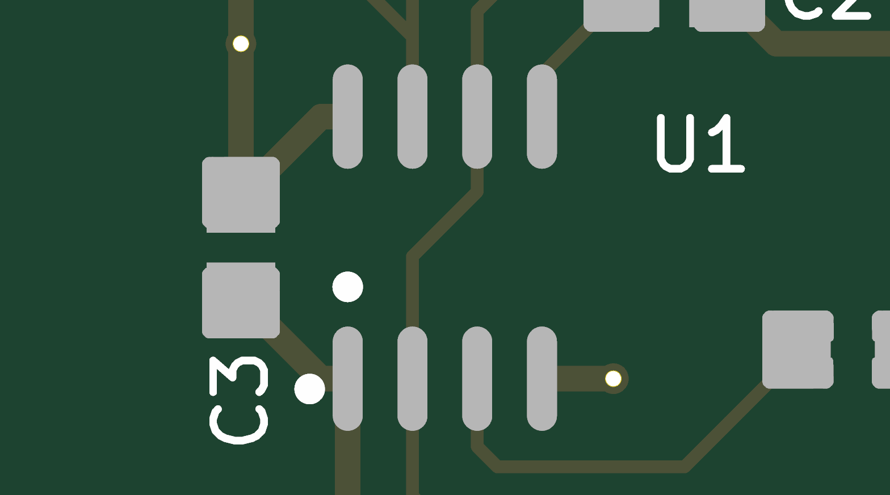
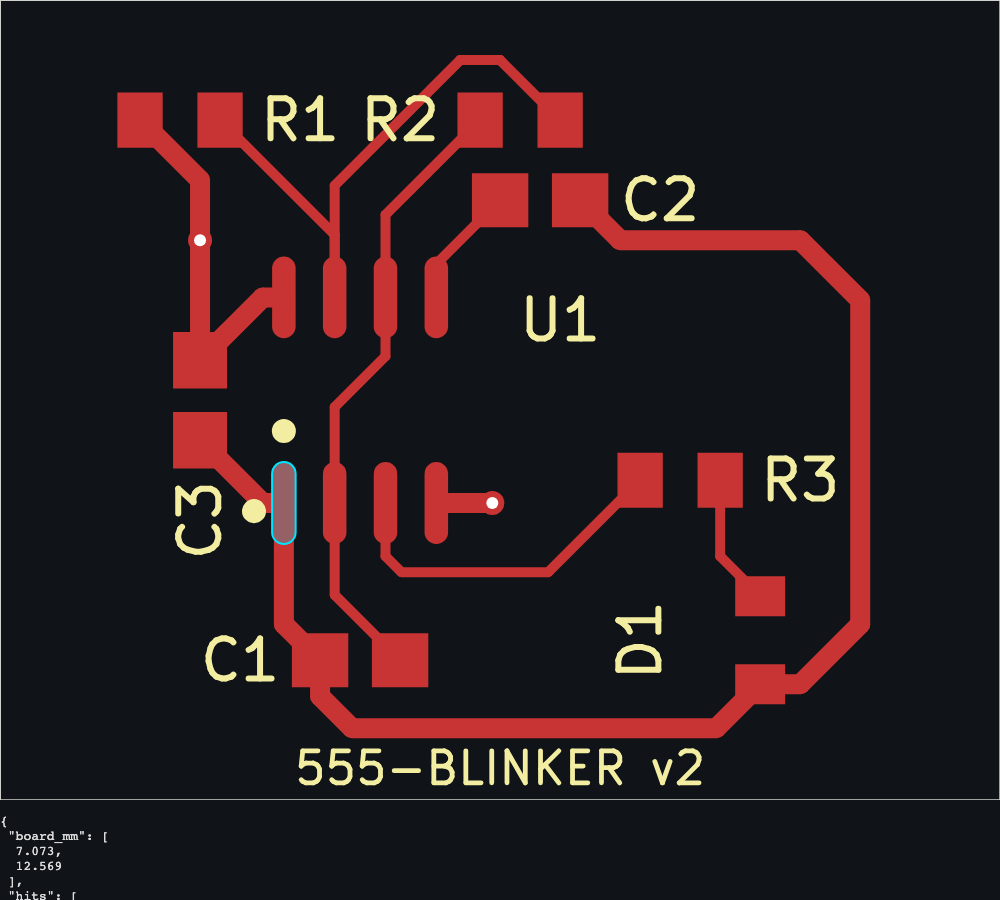

# Agent harness for KiCad + JLCPCB: framework research

**Date:** 2026-10-16

**Question:** what should the harness be built on? An agent designs KiCad boards from JLCPCB parts while the user:
- watches every step and chats with it mid-run;
- clicks parts of the design to comment on and tag them;
- reviews and rolls back versions.

The agent must inspect its own output with tools and with images, and loop until a goal is met.

**Method:**
- Five research tracks: CopilotKit, agent backends, CAD viewers and anchored comments, the KiCad/JLCPCB tool layer, and published evidence.
- Two hands-on spikes, run today against the Anthropic API (`claude-haiku-5-5`) and KiCad 10.0.3.

The spike code and recorded streams are in [`spikes/2026-10-16/`](spikes/2026-10-16/README.md). Items marked **verified** were run here; everything else cites a source.

## Recommendation

| Layer | Use | Why |
|---|---|---|
| Agent backend (headless) | **Pydantic AI 2.57** (`pydantic-ai-slim[ag-ui,anthropic]`) in FastAPI | **Verified:** a clean AG-UI stream without workarounds. Covers reasoning, tool calls, tool results, state events, approval interrupts, frontend tools, and tool images the model actually reads. Model-agnostic, MIT, no server licence |
| Agent ↔ UI protocol | **AG-UI** (1.0, Sep 2026) | One event stream for chat, tool calls, state and interrupts; the backend doesn't depend on the frontend |
| Frontend | **CopilotKit 1.79** v2 hooks, behind a self-hosted **CopilotRuntime** (Node, MIT) | Gives chat, tool-call cards, approvals, frontend tools and shared state. A direct browser→Python connection is dev-only unless you buy Enterprise |
| What the user sees | KiCad's own SVG plots plus a server-built **pick overlay** (UUID, ref, pad, net, layer for each item); a GLB 3D tab later | **Verified** exact picks of pads, tracks, vias and footprints. KiCanvas selects only footprints and drops KiCad 10 nets |
| What the agent sees | `kicad-cli pcb render` framed on mm coordinates, plus SVG viewBox crops | **Verified:** 0.45 s per framed 3D render, 0.06 s per crop |
| Versions | One git repo per design. Every mutating tool call commits; rollback means branching from an older commit | Comments, renders, DRC results and agent runs all key on commit SHAs |
| Comments | SQLite threads anchored to KiCad UUIDs plus commit and view, with tags, severity and status | Same pattern as Fictiv, AllSpice, Altium 365 and Onshape. DRC findings use the same model |
| CAD engine | KiCad 10 (upgrade 10.0.3 → **10.0.7**): a SWIG `pcbnew` worker plus `kicad-cli`; SKiDL 3 for netlists; Freerouting for routing; kipy for an optional live KiCad window | SWIG is the only headless editing API in 10.x. KiCad 11 (expected ~Feb 2027) removes it and adds a headless API server |
| Models | Claude Opus 5.5 for the main loop and the judge; Sonnet or Haiku 5.5 for cheap steps | API key from `ANTHROPIC_API_KEY` |

**Runner-up: LangGraph 1.2 + `ag-ui-langgraph` 0.0.47.**
- **For:** CopilotKit's flagship integration, and real checkpoint time travel.
- **Against:** the adapter is 0.0.x, and the spike needed six workarounds (below).

**Not recommended:**
- **Claude Agent SDK:** AG-UI only through a community adapter, Claude-only, one CLI subprocess per session, and its file checkpoints miss edits made by custom tools ([hosting](https://code.claude.com/docs/en/agent-sdk/hosting)).
- **OpenAI Agents SDK:** no AG-UI adapter ([ag-ui#2210](https://github.com/ag-ui-protocol/ag-ui/pull/2210) open since July).
- **Google ADK, Microsoft Agent Framework, Strands, Agno:** each has an AG-UI adapter, but they offer weaker Claude support or less traction for this job (see the table in [Backends compared](#backends-compared)).

"Agent-kit" turned out to mean CopilotKit. OpenAI's AgentKit (Agent Builder + ChatKit) and Inngest's AgentKit were looked at and dropped:
- **OpenAI's AgentKit:** OpenAI-centric, fixed widget UI, no ChatKit release since July.
- **Inngest's AgentKit:** TypeScript-only.

## Spike results

### AG-UI streams: Pydantic AI vs LangGraph (verified)

**Scenario:**
1. A tool renders a PNG (a random code and shape, logged only on the server) and updates the shared state.
2. A second tool needs approval before it commits.
3. Separately, the frontend tool `focus_viewer(ref)` is offered to the model.

**Pydantic AI, render then commit (32 events):**
- `RUN_STARTED`
- `REASONING_*`, including `REASONING_ENCRYPTED_VALUE` (the thinking signature)
- `TOOL_CALL_START/ARGS/END` for the render
- `CUSTOM` (a progress event emitted from inside the tool)
- `TOOL_CALL_RESULT`, then `STATE_SNAPSHOT`
- `TOOL_CALL_*` for the commit
- `RUN_FINISHED`, with `outcome.type="interrupt"` and an interrupt `int-<toolCallId>` carrying a schema of `approved`, `editedArgs` and `reason`

**Resuming:** the client starts a new run with `resume:[{interruptId, status:"resolved", payload:{approved:true}}]`. That run emits `TOOL_CALL_RESULT` → `STATE_DELTA` → text → `RUN_FINISHED`.

**Results:**
- **Images:** both frameworks' models reported the exact code and shape, so tool images reach the model.
- **Frontend tools:** in both, the run ends on the tool call. Sending the result in the next run continues the conversation.
- **LangGraph friction:**
  1. Passthrough `RAW` events are about 77% of the bytes until disabled.
  2. Every `STATE_SNAPSHOT` carries the whole message list, base64 images included, and it never sends `STATE_DELTA`.
  3. Reasoning drops out of `MESSAGES_SNAPSHOT` unless `output_version="v1"`.
  4. Tool results aren't valid JSON.
  5. The approved tool call is re-announced on resume.
  6. Frontend tools must be bound and routed to END by hand. The standard interrupt outcome is also opt-in (`emit_interrupt_outcome=True`).
- **Pydantic AI caveats:**
  - Output type must include `DeferredToolRequests`.
  - State isn't sent automatically; tools attach `StateSnapshotEvent`/`StateDeltaEvent` to their `ToolReturn`.
  - The adapter keeps no history, so the client resends the whole transcript, images included, every run. Keep history on the server.
  - Pydantic AI pins `ag-ui-protocol<1` (0.1.22), while CopilotKit 1.79 speaks AG-UI 1.0. This is untested in a browser and is the first thing to check.

### CAD views on KiCad 10.0.3 (verified)

**3D renders** (`kicad-cli pcb render`):
- **Camera mapping:** `px/mm = zoom × H / (1.0355 × max(board_w, board_h))`, where H is the requested image height.
- **Centring:** `--pivot` is in cm from the board-outline centre, +Y up. The bottom view mirrors X. Avoid `--pan`: its units depend on board size.
- **Speed:** `--quality basic` takes 0.41–0.47 s. `high` takes 1.5–2 s and adds nothing useful.
- **Legibility:** pads, vias and refdes are crisp, but tracks under solder mask are low-contrast.
- **Example:** 

**2D plots** (`kicad-cli pcb export svg --page-size-mode 2 --exclude-drawing-sheet --mode-single`):
- Units are mm, with the origin at the top-left of the board outline; export takes 0.3 s.
- Rewriting the viewBox renders any region: 6×6 mm at 200 px/mm took 0.06 s.
- The SVG carries no item IDs.

**Pick overlay:** hit shapes from a pcbnew dump, laid over the SVG, returned the right pad, track, via or footprint with its UUID and net.
- A click 0.35 mm off a track picked only the footprint; 0.26 mm outside a pad picked nothing.
- Use `pointer-events: fill`.
- 

**GLB export** (`kicad-cli pcb export glb`):
- Components become nodes named by refdes, but only when their 3D models resolve.
- Copper, pads and vias are each merged into one mesh. `--net-filter` exports one net at a time (2 s for all 7 nets).

**KiCanvas** (MIT, alpha, last commit 2026-04-28):
- Renders both formats, but KiCad 10's name-only `(net "VCC")` loses every net; `k10_to_numbered_nets.py` works around it.
- `kicanvas:select` fires on an internal object, not the page. Only footprints are selectable, and picking uses bounding boxes.
- The maintainer is rejecting LLM-assisted pull requests ([#201](https://github.com/theacodes/kicanvas/pull/201)), so expect to keep a fork.

**DRC JSON:** violation items carry `uuid` plus `pos`, which makes them usable as anchors. There's no marker position, and some violation types carry no items ([#25285](https://gitlab.com/kicad/code/kicad/-/work_items/25285)).

## Architecture

```
Browser (React + Vite)
├── CopilotKit v2 (import from /v2/headless): chat, live activity feed, tool-call cards,
│   approvals, frontend tools (focus/highlight/show_version), useAgentContext(selection)
├── Board/schematic viewer: KiCad SVG + pick overlay, comment pins, DRC pins, diff overlay
├── Version timeline (git DAG) and review panel (threads, tags, statuses)
└── 3D tab (GLB in react-three-fiber), later
        │ AG-UI over SSE                         │ REST + SSE: versions, comments, artifacts
        ▼                                        │
CopilotRuntime (Node, MIT, SqliteAgentRunner)    │
        │ AG-UI over HTTP                        │
        ▼                                        ▼
Python service (FastAPI)
├── Agent: Pydantic AI + AGUIAdapter, server-side history, usage limits, OTel traces
├── Run manager: runs owned by the server; per-run event log for replay and reattach; steering queue
├── Goal loop: goal spec → checks → iterate/stop; separate judge model; keep the best version
├── Design store: one git repo per design, a commit per mutation, branches; artifact cache per SHA
├── Review store (SQLite): threads, anchors, tags, statuses, anchor resolution per commit
└── CAD engine (separate process, KiCad's Python 3.9): SWIG pcbnew worker over JSON-RPC,
     plus kicad-cli (DRC/ERC/render/export), SKiDL netlists, Freerouting (Java 25), parts DB
```

**Notes:**
- **Headless:** a CLI (typer) can drive the same agent, goal loop and stores without a browser. The AG-UI event log is the record of every run either way.
- **Server-owned runs:** a closed tab must not cancel a run. The UI subscribes to an event log and replays it on reconnect.
- **Steering mid-run:** CopilotKit can't inject a message into a running run ([#5428](https://github.com/CopilotKit/CopilotKit/issues/5428)). Pydantic AI documents `RunContext.enqueue` for mid-run steering; feed it from a side endpoint. Unverified.
- **Visual diffs:** build them from the overlay index, diffing by UUID: added, removed, moved, net changed. KiRI and KiDiff only partly work with KiCad 10 ([kiri#142](https://github.com/leoheck/kiri/issues/142)). KiCad 11 adds `pcb diff` / `sch diff`.
- **Renders are disposable:** derive them from the commit; never commit them. `.history/` (KiCad 10's own local-history repo), `*.kicad_prl`, `fp-info-cache` and backups stay out of git.

## Agent tools

| Group | Tools |
|---|---|
| Edit | Netlist as code: SKiDL parts and connections, LCSC IDs only. `add_part(lcsc)` (import via easyeda2kicad), `place(ref, x, y, rot, side)`, `place_group` / `align`, `set_outline`, `add_zone`, `set_rules`, `route(constraints)` (Freerouting via DSN/SES), `route_manual(net, points, layer, width)` for critical nets, `delete(uuid)` |
| Inspect (structured) | `query(kind, filter)` → entities with UUID, ref, net, position, bbox, layer. `measure(a, b)` and `clearance(net_a, net_b)` (pcbnew geometry + shapely; **verified**, with UUIDs). `check()` → DRC, ERC, `--schematic-parity`, JLC `.kicad_dru` rules, custom rules. `stats()` (`pcb export stats`). `bom_cost()` (Basic vs Extended fees) |
| Inspect (visual) | `render_view(target, view_mm, layers, side, mode=2d\|3d, highlight, labels)` returns the image to the model and a URL to the UI. `render_multi(target)` gives top/bottom/iso plus a zoomed crop. Draw refdes and net labels onto the images |
| Versions | `commit` (automatic after each mutation, with run/tool-call trailers), `history`, `diff(a, b)`, `branch(from)` |
| Feedback | `list_feedback()` → open threads with anchors resolved against the current version. `reply(thread, text)`, `mark_addressed(thread, commit)`. Only the user resolves a thread |
| UI (frontend tools) | `focus(target)`, `highlight(nets\|uuids)`, `show_version(sha)`, `show_diff(a, b)`, `open_thread(id)`, so the agent can point the user at what it changed |

Build the CAD tools as a plain Python library, wrapped by both the Pydantic AI toolset and a FastMCP server. The same tools then also work in Claude Code or OpenCode. For tool design, borrow ideas from mixelpixx/KiCAD-MCP-Server (MIT, 244 tools) and mixelpixx/Konnect (IPC-first; imports Freerouting results as one undoable transaction). Konnect is AGPL, so read it but don't copy its code.

## The loop

What the evidence supports (sources in [Evidence](#evidence)):

1. **Goal spec as data.** Function as a netlist, plus constraints: size (under 40×60 mm for the laser), layer count, Basic-parts preference, maximum cost.
   - **Executable checks:** DRC, ERC and parity clean; every net routed; no open must-fix threads.
   - **Rubric checks** for the judge.
   - **Budgets:** iterations, tokens, wall time.
2. **Iterate.** Each pass: act → commit → structured checks → targeted renders aimed at failing items → plan the next step. Stream check progress to the UI as state.
3. **Structured feedback first, images second.** Text lists of overlaps and violations, each with ref, net and coordinates, fixed placement better than images (OmniLayout). Images helped with off-board parts and routing violations (OmniLayout, OmniRouting).
4. **LLM sets intent, deterministic tools do geometry.** The model chooses zones, groups, keep-outs and critical-net routes. Freerouting routes the rest; it beats LLM routing beyond small boards (PCBWorld, OmniRouting).
5. **A separate, stronger judge** (Opus checking Sonnet's work) with exact measurements cut CAD shape error from 28.4 to 0.7 (CADSmith). Agents game the measured score (RealCADBench), so the judge sees renders as well as metrics.
6. **Keep the best version, stop on stall.** Agents pass and then regress. Failing runs spend about 2.6× more tokens (pcbGPT).
7. **Human checkpoints are approval interrupts** at phase gates: BOM and part choices, placement before routing, release. Show the whole process, not just the result: feedback on the final image alone gave 0% success and oscillation (Observability Gap).
8. **Run each iteration in a fresh context** (summary + current state + failing checks + open threads) rather than one ever-growing transcript. Pydantic AI's usage limits, prompt caching and native compaction help either way.

## Anchored comments (Fictiv-style)

**What Fictiv does:** its DFM feedback ([video](https://www.youtube.com/watch?v=5gTKXZtsNww), [help](https://www.fictiv.com/help/getting-a-quote/how-do-i-review-and-approve-an-injection-molding-dfm-report)):
- Clicking a finding highlights the feature on the 3D model; draft and wall thickness show as heatmaps.
- Each finding is a *warning* (you can still order) or *revision required*.
- Expert reports mark each topic *Warning / Approval required / Revision required*.
- Responses lock once given and are submitted as a batch.
- Every revision keeps its reports, and there's a final sign-off.

**Patterns to copy from others:**
- AllSpice: reviews marked stale after new commits.
- Altium 365: a saved view and snapshot with each comment, and a "Detached" list for comments whose target is gone.
- Onshape and Autodesk: an entity reference plus camera, and the version where an issue was created and closed.
- Figma: pins offset from the node, so they follow it.
- CADLAB.io: self-hosted, KiCad 10, works with Gitea.

**Data model:**
```
Thread{id, number, kind(issue|question|dfm|drc|agent), source(human|drc|erc|agent|judge),
  severity(info|suggestion|warning|must_fix), tags[], status(open|addressed|resolved|wontfix|reopened),
  status_log[{status, by, at, commit, note}], created_commit, addressed_commit, resolved_commit, branch,
  anchor{doc(pcb|sch|3d), uuid, entity_type, refdes, pad, net, layers[], point_mm, offset_from_entity,
         region_poly, side, sheet_path},
  view{layers, bbox_mm | camera}, snapshot_png, replies[], review_id}
```

**Behaviour:**
- A *review* batches several comments and starts one agent pass, which mirrors Fictiv's batched responses.
- DRC, ERC, DFM and judge findings are threads too, keyed by rule plus item UUIDs, so they close and reopen automatically.

**Carry-forward on each commit:**
1. Resolve each anchor: UUID → refdes (+ pad) → net → nearest geometry on the same layer.
2. Record the result: exact, moved, remapped (with confidence) or detached.
3. A commit trailer `Addresses: #N` marks thread N addressed; only the user marks it resolved.

**UUID stability in KiCad 10** (from reading the source):
- Footprints, pads, zones and symbols keep their UUIDs.
- Rerouted tracks get new ones, and split schematic wires get new ones.
- Nets have no UUID, only a name.

So anchor tracks by net plus geometry, and make our own writers emit deterministic UUIDs.

## Risks to check first

1. **CopilotKit ↔ Pydantic AI over AG-UI 0.1 vs 1.0:** check in a real browser before building on it. The fallback is assistant-ui's `useAgUiRuntime`: MIT, with no Node layer.
2. **CopilotKit gaps:**
   - Its own showcase disables `useInterrupt` demos for Pydantic AI and LangGraph because of a resume bug ([manifest](https://github.com/CopilotKit/CopilotKit/blob/main/showcase/integrations/langgraph-fastapi/manifest.yaml)).
   - Long runs with many tool calls freeze the chat view ([#6301](https://github.com/CopilotKit/CopilotKit/issues/6301)). Render the activity feed from our own event log.
   - Telemetry is on by default (`COPILOTKIT_TELEMETRY_DISABLED=true`).
3. **Licensing:** a direct browser→backend connection in production (`selfManagedAgents`) is Enterprise-only ([docs](https://docs.copilotkit.ai/backend/self-managed-agents)). Use the MIT runtime; `agents__unsafe_dev_only` is fine for local hacking.
4. **Placement is the weakest LLM skill.** Every model tested overlapped parts (OmniLayout). Add deterministic placement helpers and overlap feedback, and measure whether renders help Claude 5.5 here.
5. **KiCad 11 removes SWIG.** Keep the CAD engine behind one interface; port it to kipy or the headless API server when 11 ships.
6. **Freerouting ≥ 2.2 needs Java 25** (Java 21 is installed; the native macOS CLI crashed). A test here with a downloaded Java 25 runtime did a full round trip: SWIG DSN export → Freerouting → SES import → DRC. It routed the stripped blinker in 1.2 s with nothing left unconnected, but left 0.15 mm fan-outs against a 0.2 mm minimum. Set width rules in the DSN.
7. **Parts data is stale:** the local DB's newest `last_update` is 2025-11-18, although the file was added to the repo on 2026-03-04. Refresh it daily ([CDFER](https://github.com/CDFER/jlcpcb-parts-database)), with [jlcsearch](https://github.com/tscircuit/jlcsearch) as a live fallback.
8. **Cost:** long loops with images add up. Keep history server-side, cache prompts, send crops rather than full renders, and use Haiku for mechanical steps.

## Build plan

1. **Walking skeleton (the blinker board):**
   - FastAPI + Pydantic AI with about six tools: `render_view`, `query`, `check`, `place`, `commit`, `list_feedback`.
   - A Vite app with CopilotKit, the runtime, the activity feed, render cards and approvals.
   - An SVG viewer with the pick overlay and comment pins.
   - Git versions and a timeline.
   - **Verify with Playwright in a real browser:** the stream shows reasoning and tool calls; approvals round-trip; select → comment → agent addresses → new version → comment carried forward; rollback creates a branch.
2. **Breadth:**
   - SKiDL netlists, parts search and import, Freerouting, zones, outline.
   - Goal spec, loop controller and judge.
   - Run event log with replay.
   - Logfire, or self-hosted Langfuse or Phoenix (Logfire self-hosting is Enterprise-only).
   - An eval suite of 5–10 boards in `pydantic-evals` with executable graders.
3. **Depth:**
   - 3D tab, schematic viewer and overlay, diff views.
   - A live KiCad window via kipy.
   - KiCad 11 migration.
   - Fab outputs (kicad-cli jobsets, KiBot JLC templates); laser hand-off for in-house milling.

## Problems found in this repo

- **Duplicate pad UUIDs.** `demo/layout.py` copies library footprint UUIDs into every instance, so C1/C2/C3 share pad UUIDs, as do R1/R2/R3. With a deliberate short, DRC blamed `C3` instead of `C2` until the UUIDs were made unique (`dedupe_uuids.py`). Don't anchor anything to these boards' UUIDs; the new writers need per-instance, deterministic UUIDs.
- **R0805/C0805 3D models sit one pad off** (`(offset (xyz -1.413 0 0))`). Their `packages3d/` paths don't resolve from `demo/`, which hides it.
- **KiCad 10.0.3 bug:** ERC JSON coordinates are 100× too small ([#25582](https://gitlab.com/kicad/code/kicad/-/work_items/25582); fixed in 10.0.7). Also, kipy 0.8.0 targets the 10.0.6 API.
- **Old footprint format.** `research/libs/JLC2KiCad_lib` writes KiCad 5 footprints; easyeda2kicad 1.0.1 writes KiCad 6+ with STEP models.

## Backends compared

●● strong · ● yes · ◐ partial · ✗ none

| | AG-UI | Thinking events | Image tool results | Approvals | Rewind/fork | Claude features | Model-agnostic | Maturity |
|---|---|---|---|---|---|---|---|---|
| Pydantic AI 2.57 | ●● first-party | ● | ●● inside tool_result | ● interrupt | ◐ `fork_run` (0.x) | ●● | ●● | v2, weekly releases |
| LangGraph 1.2 | ●● adapter 0.0.47 | ● | ● | ● `interrupt()` | ●● checkpoints | ● | ● | 1.x |
| Google ADK 2.12 | ●● | ● | ◐ follow-up message | ● | ● rewind | ◐ LiteLLM | ● | 2.x |
| MS Agent Framework 1.22 | ●● | ● | ● | ● | ◐ workflows | ◐ prerelease | ● | GA Apr 2026 |
| Strands 1.61 | ●● | ● | ● | ● | ◐ | ● | ● | 1.x |
| Claude Agent SDK 0.2 | ◐ community | ● | ● | ● | ◐ | ●● | ✗ | 0.x |
| OpenAI Agents SDK 0.24 | ✗ | – | ● | ● | ✗ | ◐ | ◐ | 0.x |

Sources:
- [AG-UI integrations](https://github.com/ag-ui-protocol/ag-ui/blob/main/apps/dojo/src/menu.ts)
- [Pydantic AI AG-UI](https://pydantic.dev/docs/ai/integrations/ui/ag-ui/)
- [Pydantic AI tools](https://pydantic.dev/docs/ai/tools-toolsets/tools-advanced/)
- [LangGraph time travel](https://docs.langchain.com/oss/python/langgraph/use-time-travel)
- [ADK rewind](https://adk.dev/sessions/session/rewind/)
- [MAF AG-UI](https://github.com/microsoft/agent-framework/tree/main/python/packages/ag-ui)

Licensing: LangGraph's Agent Server is Elastic-2.0 and needs a licence key to self-host, but the plain library behind FastAPI doesn't ([docs](https://docs.langchain.com/langsmith/deploy-standalone-server)).

## Evidence

| Finding | Source |
|---|---|
| Netlist as code works: 90% first-try pass (GPT-5.3-Codex). Failures: missing support parts, interface wiring, values | [pcbGPT, 2606.01188](https://arxiv.org/abs/2606.01188) |
| Every model overlaps parts in placement. Text overlap feedback beats images for overlaps | [OmniLayout, 2607.03261](https://arxiv.org/abs/2607.03261) |
| Agents acting through KiCad with DRC feedback beat open-loop LLMs. Freerouting wins on larger boards | [PCBWorld, 2607.05915](https://arxiv.org/abs/2607.05915) |
| LLM routing trails classical routers. Visual feedback reduced violations for all models | [OmniRouting, 2608.04434](https://arxiv.org/abs/2608.04434) |
| Exact measurements plus a separate stronger judge cut CAD error from 28.4 to 0.7 | [CADSmith, 2603.26512](https://arxiv.org/abs/2603.26512) |
| Agents game measured metrics | [RealCADBench, 2609.03773](https://arxiv.org/abs/2609.03773) |
| Feedback on final images only: 0% success, oscillation | [Observability Gap, 2603.26942](https://arxiv.org/abs/2603.26942) |
| Zoomed crops raised drawing-reading accuracy by 13 points | [LED-BENCH, 2610.19571](https://arxiv.org/abs/2610.19571) |
| Opus 5.5 75.0, GPT-6 Astra 69.3, Sonnet 5.5 67.2, Haiku 5.5 67.1 (atopile + SPICE, ±8–11) | [EEBench](https://eebench.org/) |
| Opus 5.5 rebuilt a 47-part design, routed DRC-clean via Freerouting. Netlist read-back found 6 missing GNDs. Claude never saw the board, so visual review stayed human | [JLCPCB blog, 2026-10-13](https://jlcpcb.com/blog/claude-code-pcb-design) |

The source-checked items are PCBWorld, OmniLayout and the JLCPCB post; the other figures are as reported by the research track.

## Main references

**Frontend:**
- [CopilotKit releases](https://github.com/CopilotKit/CopilotKit/releases) (1.79.1, 2026-10-15)
- [v2 migration](https://docs.copilotkit.ai/migrate/v2)
- [which hook](https://docs.copilotkit.ai/concepts/which-hook)
- [headless](https://docs.copilotkit.ai/headless)
- [human-in-the-loop](https://docs.copilotkit.ai/human-in-the-loop)
- [shared state](https://docs.copilotkit.ai/shared-state)
- [OSS vs Intelligence](https://docs.copilotkit.ai/concepts/oss-vs-enterprise)
- [AG-UI 1.0 changelog](https://docs.ag-ui.com/spec/1.0/changelog)
- Alternative: [assistant-ui AG-UI runtime](https://www.assistant-ui.com/docs/runtimes/ag-ui/quickstart.md)

**KiCad:**
- [IPC API docs](https://dev-docs.kicad.org/en/apis-and-binding/ipc-api/)
- [kicad-python](https://gitlab.com/kicad/code/kicad-python) (kipy 0.8.0)
- [SWIG deprecation](https://dev-docs.kicad.org/en/apis-and-binding/pcbnew/)
- [post-v10 development news](https://forum.kicad.info/t/post-v10-new-features-and-development-news/66611)
- [SKiDL](https://github.com/devbisme/skidl) (3.0.0)
- [Freerouting](https://github.com/freerouting/freerouting) (v2.5.0)
- [KiCAD-MCP-Server](https://github.com/mixelpixx/KiCAD-MCP-Server)
- [Konnect](https://github.com/mixelpixx/Konnect)
- [kicad-mcp-pro](https://github.com/oaslananka/kicad-mcp-pro)

**Viewers and review:**
- [KiCanvas](https://github.com/theacodes/kicanvas)
- [ecad-viewer](https://github.com/Huaqiu-Electronics/ecad-viewer)
- [InteractiveHtmlBom](https://github.com/openscopeproject/InteractiveHtmlBom)
- [KiRI](https://github.com/leoheck/kiri)
- [AllSpice API objects](https://github.com/AllSpiceIO/py-allspice/blob/main/allspice/apiobject.py)
- [Altium 365 commenting](https://www.altium.com/documentation/altium-designer/document-commenting)
- [Figma comment anchors](https://developers.figma.com/docs/rest-api/comments-property-types)
- [CADLAB.io self-hosted](https://github.com/CADLAB-io/CADLAB.io-swarm-stack/releases)
